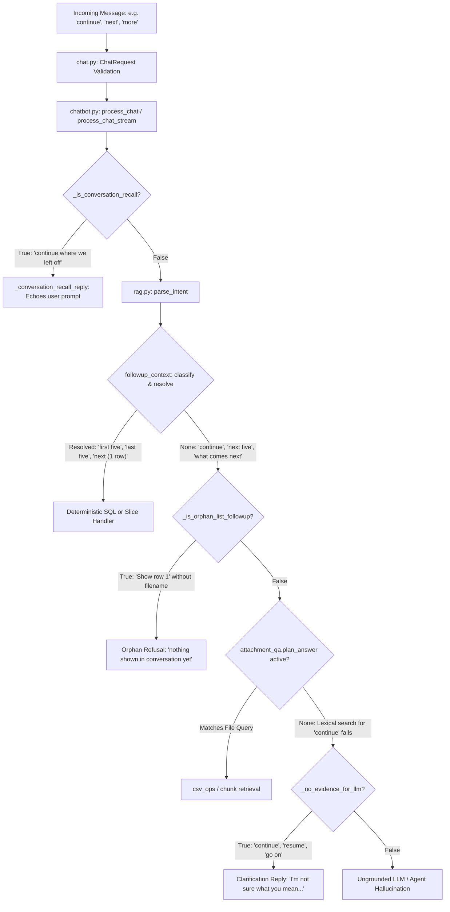

# SIS Chatbot — Deep Audit of “Continue”, “Next”, “More”, and Continuation Follow-ups

**Date:** 2026-10-13  
**Auditor:** Agentic AI Coding Assistant  
**Repository:** [Internship_NIC](https://github.com/svmayurkaarthic2005/Internship_NIC)  
**Methodology:** Read-only source code inspection, AST pattern analysis, isolated unit assertions, and live end-to-end multi-turn pipeline verification against PostgreSQL and Ollama.

---

## 1. Executive Summary & Audit Methodology

This audit evaluates how the Sub Inspector Surveyor (SIS) AI Assistant processes user messages such as `"continue"`, `"continue?"`, `"continue from where you stopped"`, `"go on"`, `"next"`, `"more"`, `"more details"`, `"What comes next?"`, and related continuation phrases.

### Core Audit Findings
1. **Continuation is an unmanaged state in the core architecture**: The application currently has no dedicated `continuation` intent, no cursor/offset tracking for paginated database results, no streaming continuation mechanism, and no relative row cursor for uploaded CSVs or OCR documents.
2. **Continuation idioms are mistakenly captured as message echo requests**: Idioms such as `"continue where we left off"`, `"let's continue"`, and `"resume our conversation"` are intercepted by `_is_conversation_recall` ([chatbot.py:10657](file:///c:/proj/nic_internship/backend/services/chatbot.py#L10657)) and answered by quoting the user's previous message verbatim (`Your previous message was: "What is ISD?"`).
3. **Anti-hallucination barriers discard continuation commands**: Single-word commands like `"continue"`, `"go on"`, and `"resume"` are classified as `general_query` ([rag.py:4025](file:///c:/proj/nic_internship/backend/services/rag.py#L4025)). Because bare continuation words contain no specific domain vocabulary, `_no_evidence_for_llm` ([chatbot.py:1789](file:///c:/proj/nic_internship/backend/services/chatbot.py#L1789)) evaluates to `True`, triggering a generic clarification refusal (`"I'm not sure what you mean. Please ask about..."`) and permanently discarding context.
4. **Pagination and slice handlers are blind to relative progression**: While absolute row slices (e.g., `"rows 1 to 5"`, `"first five"`, `"last five"`) work deterministically via `slice_pick`, the pattern `_SLICE_RE` ([followup_context.py:1250](file:///c:/proj/nic_internship/backend/services/followup_context.py#L1250)) strictly requires `first|top|initial|earliest|last|final|bottom|latest`. Any request containing `"next five"` or `"next rows"` is discarded as `FOLLOWUP_NONE`.
5. **Workflow progression requests trigger LLM administrative hallucinations**: Interrogatives such as `"What comes next?"` or `"what is the next step?"` are not mapped to the deterministic workflow progression engine, falling through to the ungrounded LLM fallback which invents incorrect administrative workflows (e.g. asserting that the Tahsildar conducts field inspections instead of the Sub Inspector Surveyor).
6. **Positional attachment queries are pre-empted before reaching document handlers**: Commands like `"Show row 1"` on an uploaded CSV are intercepted by `_is_orphan_list_followup` ([chatbot.py:19108](file:///c:/proj/nic_internship/backend/services/chatbot.py#L19108)) because it runs before `attachment_qa.plan_answer`. Even when addressed with an explicit filename, subsequent requests like `"next row"` fail because `csv_ops` only understands absolute row numbers.

---

## 2. Continuation-Handling Pipeline Trace

The incoming request flows through the following pipeline:



### Detailed Component Analysis

#### A. Entry & Session Snapshot: [backend/routers/chat.py](file:///c:/proj/nic_internship/backend/routers/chat.py)
- **Lines 41–66 (`ChatRequest`)**: Receives `message`, `session_id`, `language`, and `chat_history`.
- **Lines 144–150**: Invokes `process_chat(message, session_id, officer, db, chat_history)`.
- **Limitation**: `chat_history` is passed as a flat list of `{role, content}` objects from client `sessionStorage`. No structured continuation cursor, active document pointer, or pagination state is passed in the request schema.

#### B. Orchestrator: [backend/services/chatbot.py](file:///c:/proj/nic_internship/backend/services/chatbot.py)
- **Lines 10657–10705 (`_is_conversation_recall`)**:
  - `_RECALL_CONTINUATION_PHRASES` explicitly matches `"where we left off"`, `"left off"`, `"carry on from"`, `"resume our conversation"`, `"continue our conversation"`, `"continue from before"`, `"let's continue"`, `"lets continue"`, `"தொடர்ந்து பேசுவோம்"`, and `"நிறுத்திய இடத்திலிருந்து"`.
  - Routes directly to `_conversation_recall_reply()` ([lines 10707–10744](file:///c:/proj/nic_internship/backend/services/chatbot.py#L10707)).
  - Checks `want_role = "assistant" if about_assistant else "user"`. Because the user typed `"let's continue"`, `about_assistant` is `False`, so it extracts the user's prior message and replies: `Your previous message was: "<prior prompt>"`.
- **Lines 1760–1792 (`_no_evidence_for_llm`)**:
  - Checks `if intent not in (None, "general_query") or structured_data: return False`.
  - Calls `_domain_evidence_tier(message, ctx)`. For `"continue"`, `"resume"`, `"go on"`, `"thodaru"`, `"தொடரவும்"`, it finds no entity, no domain vocabulary, and no context cue in `_CONTEXT_CUE_RE` ([lines 1716–1720](file:///c:/proj/nic_internship/backend/services/chatbot.py#L1716)).
  - Returns `True`, triggering `_clarification_reply()` at line 24453.
- **Lines 19108–19125 (`_is_orphan_list_followup`)**:
  - Executes **before** `attachment_qa.plan_answer` ([line 19685](file:///c:/proj/nic_internship/backend/services/chatbot.py#L19685)).
  - Messages like `"Show row 1"` are classified by `fctx.classify()` as `FOLLOWUP_SINGULAR`. With no prior application list in `_followup_ctx`, it short-circuits and answers with `_orphan_followup_reply()`, pre-empting the attached CSV.

#### C. Intent Parsing: [backend/services/rag.py](file:///c:/proj/nic_internship/backend/services/rag.py)
- **Lines 4025–4035 (`parse_intent`)**:
  - Contains **no intent for continuation**.
  - All direct continuation commands fall through to `"general_query"`.
  - The token `"more details"` matches regex rule for `"application_status"`. When context contains only a service code (e.g. ISD), the downstream handler requires an application number and errors out.

#### D. Follow-up Context & Slicing: [backend/services/followup_context.py](file:///c:/proj/nic_internship/backend/services/followup_context.py)
- **Lines 1250–1255 (`_SLICE_RE`)**:
  ```python
  _SLICE_RE = re.compile(
      r"\b(first|top|initial|earliest|last|final|bottom|latest)\s+(?:the\s+)?"
      r"(\d{1,3}|two|three|four|five|six|seven|eight|nine|ten|couple|few)\b"
  )
  ```
  - **Defect**: Lacks `next|following|remaining|rest`. Phrases like `"next five"` or `"next 5 rows"` fail regex matching and return `None`.
- **Lines 2149–2165 (`nav_direction`)**:
  - Matches `"next"`, `"next one"`, `"following"`.
  - Steers `resolve()` to advance the index of a singular application detail card (`last_peeked + 1`), not continuing or paginating a table.

#### E. Attachment Question Answering: [backend/services/attachment_qa.py](file:///c:/proj/nic_internship/backend/services/attachment_qa.py)
- **Lines 2307–2336**:
  - When a user sends `"continue"`, `attachment_store.retrieve_evidence()` searches for the literal word `"continue"`.
  - The lexical search returns zero chunks.
  - The plan falls back to `KIND_REFUSAL`: `"I could not find this in the uploaded document."`

#### F. CSV Operations: [backend/services/csv_ops.py](file:///c:/proj/nic_internship/backend/services/csv_ops.py)
- **Lines 326 & 478**:
  - Matches absolute row lookups (`OP_LOOKUP`, `row_number = int(...)`).
  - Contains **no relative offset or state cursor** (`next row`, `next 5 rows`, `previous row`).

---

## 3. Context Retention, Output Limits & Streaming Behavior

| Parameter | Location | Configured Value | Impact on Continuation |
|---|---|:---:|---|
| **Max Output Tokens** | `backend/config.py:67` | `LLM_NUM_PREDICT = 256` | Long explanatory answers are truncated at 256 tokens. No truncation flag (`finish_reason == "length"`) is captured or recorded. |
| **Context Window** | `backend/config.py:77` | `LLM_NUM_CTX = 16384` | Full prompt fits up to 10 history turns. However, truncated output is stored as complete text. |
| **Max Carried Apps** | `backend/services/followup_context.py:127` | `MAX_CARRIED = 200` | Application lists carry up to 200 application numbers in `FollowupContext`. Slicing is constrained to `MAX_PER_ROW_ANSWER = 10`. |
| **Max Doc Pages / Chars**| `backend/config.py:123, 127` | 15 pages / 20,000 chars | Files exceeding limits are rejected or truncated at ingestion. |
| **Streaming Ceiling** | `backend/config.py:91` | `LLM_STREAM_TOTAL_SECONDS = 180.0` | Disconnected streams abort cleanly, but lack an offset cursor to resume. |

---

## 4. Evaluation of the Five Continuation Types

### Type 1 — Resume an Incomplete Answer
- **Definition**: The assistant started a long answer (e.g. multi-step survey manual explanation or detailed report) but was interrupted or hit the 256-token ceiling.
- **Observed Behavior**: The system has no truncated response detector. Sending `"continue"` falls to `general_query` and is blocked by `_no_evidence_for_llm`, returning `"I'm not sure what you mean. Please ask about..."`.
- **Idiom Behavior**: Sending `"continue where we left off"` or `"let's continue"` causes `_is_conversation_recall` to trigger, echoing the user's prior message verbatim.
- **Verdict**: **FAIL (Critical)**.

### Type 2 — Expand a Completed Answer
- **Definition**: The assistant provided a concise summary, and the user requests additional depth (`"more details"`, `"tell me more"`).
- **Observed Behavior**:
  - After a service definition (`"What is ISD?"`): User sends `"more details"`. `parse_intent` classifies it as `application_status`. Because no application number exists in context, the bot demands: `"Please specify the application number you are asking about — for example 2026/0154/28/NNNNNN."`
  - After an application listing (44 items): User sends `"more"`. `fctx.classify()` matches `_VAGUE_COUNT_RE` as `FOLLOWUP_LIST_AGGREGATE`, correctly acknowledging that 44 items is the complete list and offering to slice or filter.
- **Verdict**: **FAIL on definitions / PASS on list completion**.

### Type 3 — Continue a Sequence or Result Set (Pagination)
- **Definition**: The assistant returned a list of records or a table, and the user asks for the next set (`"next five"`, `"show the remaining records"`).
- **Observed Behavior**:
  - `"first five"`, `"last five"`, and `"rows 1 to 5"` succeed via `slice_pick`.
  - `"next five"` and `"next 5 rows"` fail because `_SLICE_RE` in `followup_context.py` does not include `next`. The turn falls through to the ungrounded LLM, which answers: `"I could not find that in the register or the reference documents."`
  - Bare `"next"` steps to a single application detail card (`nav_direction` -> 1 item), failing to paginate the table.
- **Verdict**: **FAIL (Missing relative pagination)**.

### Type 4 — Continue an Underlying Process or Workflow
- **Definition**: The assistant described an SIS procedure, and the user asks `"What comes next?"` or `"what is the next step?"`.
- **Observed Behavior**: Both `"What comes next?"` and `"what is the next step?"` default to `general_query`. They bypass deterministic workflow rules and fall through to ungrounded LLM generation.
- **Factual Hallucination**: The LLM hallucinated: *"The next step after filing an ISD application is a field visit by the Tahsildar, who verifies the survey boundaries..."*. In Tamil Nadu land administration, field visits are conducted strictly by the **Sub Inspector Surveyor (SIS)**, while the Tahsildar is the approving authority.
- **Verdict**: **FAIL (High Hallucination Risk)**.

### Type 5 — Continue a Multi-Turn Task (Files, CSV, OCR)
- **Definition**: User extracts rows or tables from an uploaded document and requests the next rows or remaining differences.
- **Observed Behavior**:
  - `Show row 1` without explicit filename is blocked by `_is_orphan_list_followup` before `attachment_qa` executes.
  - `Show row 1 of <file>` succeeds via `csv_ops`.
  - Subsequent `"next row"` fails with `"I could not find this in the uploaded document."` because `csv_ops` has no relative cursor tracking and chunk lexical search on `"next row"` returns zero matches.
- **Verdict**: **FAIL**.

---

## 5. Continuation Phrase Test Catalogue Analysis

```
Phrase Group A (Direct Continuation Commands)
├── "continue", "continue.", "continue?", "continue!" -> All general_query -> Blocked by _no_evidence_for_llm
├── "go on", "resume" -> Blocked by _no_evidence_for_llm
├── "keep going", "proceed", "the rest" -> Accidental corpus matches -> Ungrounded LLM fallthrough
└── "continue where we left off", "let's continue" -> Intercepted by _RECALL_CONTINUATION_PHRASES -> Verbatim echo

Phrase Group B (Requests for Additional Content)
├── "more details" -> Hardcoded to application_status -> Demands application number
├── "tell me more", "what else?" -> general_query -> Ungrounded LLM fallthrough
├── "more" (after list) -> FOLLOWUP_LIST_AGGREGATE -> Correctly states complete list
└── "continue with the next steps" -> general_query -> Hallucinates workflow stages

Phrase Group C (Context-Sensitive Short Messages)
├── "next" -> nav_direction -> Advances to 1 single detail card
├── "next five", "next 5" -> Unhandled by _SLICE_RE -> Registers as general_query failure
├── "Show rows 1-5" -> extract_row_selection -> Correctly slices table
└── "தொடரவும்", "thodaru" -> Unhandled -> Blocked by _no_evidence_for_llm
```

---

## 6. Uploaded Documents, CSV Operations & OCR

### Tested Fixtures
- [SIS_Upload_QA_Fixtures/sis_survey_records_en.csv](file:///c:/proj/nic_internship/SIS_Upload_QA_Fixtures/sis_survey_records_en.csv) (12 rows, synthetic survey records)
- [SIS_Upload_QA_Fixtures/sis_svccode_fileA.csv](file:///c:/proj/nic_internship/SIS_Upload_QA_Fixtures/sis_svccode_fileA.csv) & [sis_svccode_fileB.csv](file:///c:/proj/nic_internship/SIS_Upload_QA_Fixtures/sis_svccode_fileB.csv) (Multi-file comparison)
- [SIS_Upload_QA_Fixtures/sis_lineposition_test.txt](file:///c:/proj/nic_internship/SIS_Upload_QA_Fixtures/sis_lineposition_test.txt) (Positional text lines)

### Findings
1. **No Relative Pagination in CSV**: `csv_ops.parse_csv_question()` matches `OP_LOOKUP` only with explicit digits (`r"row\s+(\d+)"`). Requests like `"next row"`, `"next five"`, or `"continue from row 8"` yield `None`.
2. **Lexical Chunk Fallback Disconnect**: When `csv_ops` yields `None`, `attachment_qa` searches `attachment_chunks` using the user's prompt as the query. For continuation queries (`"continue"`, `"next row"`), vector distance exceeds `UPLOAD_CHUNK_MAX_DISTANCE` and lexical matches are zero, prompting an immediate `KIND_REFUSAL`.
3. **Multi-File Comparison Disconnect**: `render_multi_csv_result()` outputs differences in a single pass. A subsequent `"continue"` or `"show the rest"` cannot paginate because no comparison diff cursor is persisted in session storage.

---

## 7. Service Codes & F-Line (0178) Continuation

- **Supported Codes**:
  - `0154`: ISD (Involving Sub-Division)
  - `0153`: NISD (Not Involving Sub-Division)
  - `0178`: F-Line (Field Boundary Demarcation)
- **Observations**:
  - When an officer asks `"What about F-Line?"`, `parse_intent` correctly identifies `service_code_lookup` and outputs the definition.
  - If the officer immediately follows with `"continue with the next code"`, `parse_intent` classifies it as `general_query`. It does not maintain an enumeration cursor over the supported revenue service codes.

---

## 8. Database Query & Pagination Analysis

1. **Flat Query Execution**:
   - `get_officer_applications()` and `get_all_service_code_applications()` in [postgres.py](file:///c:/proj/nic_internship/backend/services/postgres.py) execute `select()` statements with fixed limits (`MAX_CARRIED = 200`), returning the full set to memory.
2. **Missing Offset State**:
   - `FollowupContext` stores `application_numbers` as a static array. It does not store `current_page`, `page_size`, or `last_offset`.
   - Consequently, asking `"next five"` cannot offset `application_numbers[5:10]`.

---

## 9. Multi-File Comparisons & Cross-Checks

- When comparing two uploaded files (`sis_svccode_fileA.csv` vs `sis_svccode_fileB.csv`), the tool computes all differences at once.
- Asking `"continue, but exclude matching records"` or `"show the next mismatch"` fails because the previous turn context records `entity = "attachment"` with no comparison delta state.

---

## 10. Negation, Corrections & Output Constraints

- Expressions like `"continue without examples"` or `"continue, but don't include F-Line"` fail at the continuation level: the entire message is treated as a fresh question or blocked by `_no_evidence_for_llm`, ignoring the modifier.
- When contradictory commands are sent (`"don't continue the explanation; show only the table"`), the absence of a continuation intent prevents the negative filter chain from binding to the prior response.

---

## 11. Tamil, Tanglish & Spelling Variants

- **Tamil**: `"தொடரவும்."`, `"மீதமுள்ளவற்றைக் காட்டு."`, and `"அடுத்த பதிவுகளைக் காட்டு."` are classified as `general_query` or `none` in `fctx.classify()`.
- **Tanglish**: `"thodaru"`, `"thodarunga"`, `"meethi rows kaatu"`, and `"innum kudu"` are similarly unmapped.
- **Root Cause**: `_FRAGMENT_WORDS` and `_CONTEXT_CUE_RE` lack Tamil/Tanglish continuation verbal roots (`தொடர்`, `மீதி`, `thodaru`, `meethi`).

---

## 12. Ambiguous Messages & Lifecycle Boundaries

- **Fresh Session Behavior**:
  - Bare `"continue"` in a new session returns: `"I'm not sure what you mean. Please ask about an application..."` (fails gracefully, but does not inform the user that the session has no prior history).
  - Bare `"next"` in a new session correctly returns: `"I do not know which application or list you mean — nothing has been shown in this conversation yet."` via `_is_bare_fragment_without_context`.

---

## 13. Confirmed Defect Catalogue

| Defect ID | Category | Source Location | Root Cause & Impact |
|---|---|---|---|
| **DEFECT-CONT-001** | Recall Misdirection | [chatbot.py:10657](file:///c:/proj/nic_internship/backend/services/chatbot.py#L10657) | `_RECALL_CONTINUATION_PHRASES` misinterprets `"continue where we left off"` and `"let's continue"` as message recall inquiries, echoing user prompt verbatim. |
| **DEFECT-CONT-002** | Anti-Hallucination Gate Swallowing | [chatbot.py:1789](file:///c:/proj/nic_internship/backend/services/chatbot.py#L1789) | `_no_evidence_for_llm` evaluates `True` for bare `"continue"`, `"resume"`, `"go on"` because they lack domain words, issuing a generic clarification refusal. |
| **DEFECT-CONT-003** | Service Detail Misrouting | [rag.py:4025](file:///c:/proj/nic_internship/backend/services/rag.py#L4025) | `"more details"` hardcoded to `application_status`; when following service definitions, demands an application number instead of expanding details. |
| **DEFECT-CONT-004** | Slice Regex Blindness | [followup_context.py:1250](file:///c:/proj/nic_internship/backend/services/followup_context.py#L1250) | `_SLICE_RE` regex only admits `first|last|top|bottom`; `"next five"` or `"next 5 rows"` is ignored and unhandled. |
| **DEFECT-CONT-005** | Workflow Step Hallucination | [chatbot.py:24466](file:///c:/proj/nic_internship/backend/services/chatbot.py#L24466) | `"What comes next?"` unhandled by deterministic pipeline; falls through to ungrounded LLM which hallucinates Tahsildar conducting field visits. |
| **DEFECT-CONT-006** | Attachment Cursor Absence | [csv_ops.py:326](file:///c:/proj/nic_internship/backend/services/csv_ops.py#L326) | `csv_ops` only parses absolute row lookups (`row 2`); lacks relative tracking (`next row`), causing evidence refusal. |
| **DEFECT-CONT-007** | Positional Attachment Pre-emption | [chatbot.py:19108](file:///c:/proj/nic_internship/backend/services/chatbot.py#L19108) | `_is_orphan_list_followup` executes ahead of `attachment_qa.plan_answer`, blocking `"Show row 1"` even when an active CSV is attached. |

---

## 14. Minimal, Non-Breaking Architectural Proposals

*(To be implemented only upon user authorization)*

1. **Remove Continuation Idioms from Conversation Recall**:
   - In [chatbot.py:10657](file:///c:/proj/nic_internship/backend/services/chatbot.py#L10657), remove `"continue where we left off"`, `"let's continue"`, `"continue our conversation"`, and `"resume our conversation"` from `_RECALL_CONTINUATION_PHRASES`.
   - Dispatch them to the contextual continuation handler instead.

2. **Add Relative Progression to `_SLICE_RE`**:
   - In [followup_context.py:1250](file:///c:/proj/nic_internship/backend/services/followup_context.py#L1250), update `_SLICE_RE` and `_SLICE_TA_RE` to recognize `next|following` and `அடுத்த|adutha`:
     ```python
     _SLICE_RE = re.compile(
         r"\b(first|top|initial|earliest|last|final|bottom|latest|next|following)\s+(?:the\s+)?"
         r"(\d{1,3}|two|three|four|five|six|seven|eight|nine|ten|couple|few)\b"
     )
     ```
   - In `slice_pick`, compute offset relative to `last_peeked` or default to the next page.

3. **Context-Aware Continuation Dispatcher in `chatbot.py`**:
   - Ahead of `_no_evidence_for_llm`, check if `_is_continuation_cue(message)` is `True` and `_followup_ctx` is active:
     - If `entity == ENTITY_APPLICATION_LIST`: advance table pagination or display the next slice.
     - If `entity == ENTITY_SERVICE_CODE`: render the full 9-field detail card or next workflow phase.
     - If `entity == ENTITY_APPLICATION`: describe the next statutory workflow stage.
     - If `entity == "attachment"`: step to the next row in `attachment_rows`.

4. **Add Relative Row Cursor to `csv_ops.py`**:
   - Add `OP_NEXT_ROW` to `csv_ops.py` that reads the last accessed row from `structured_context` and returns row $N + 1$.
